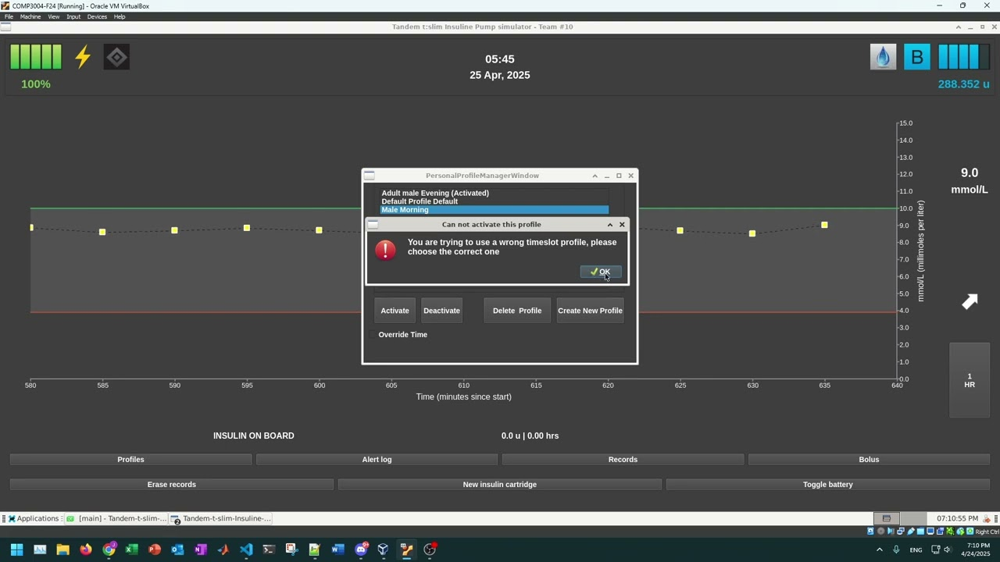
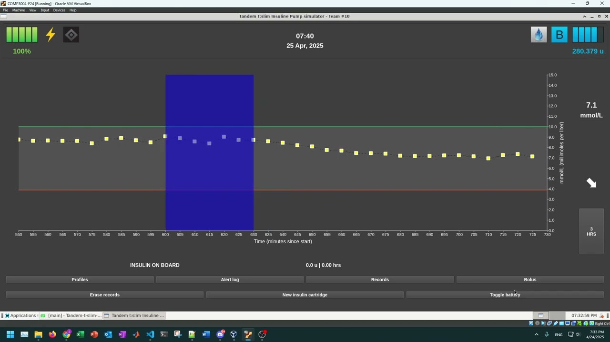
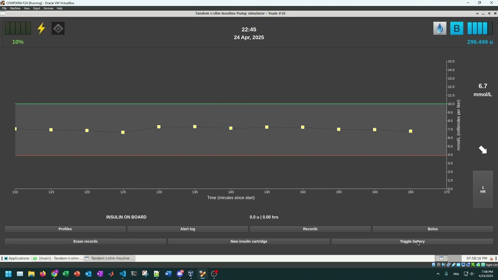
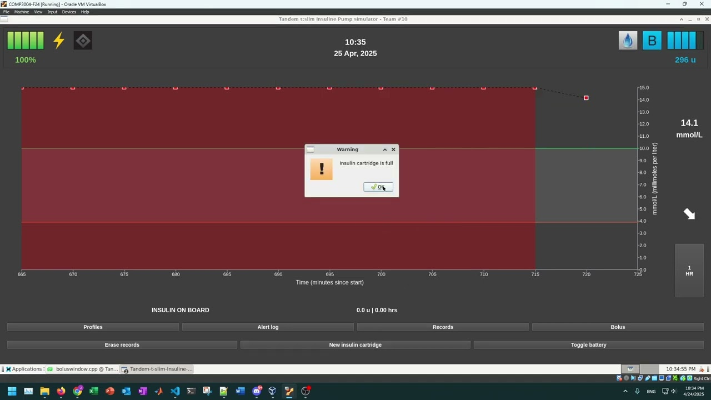
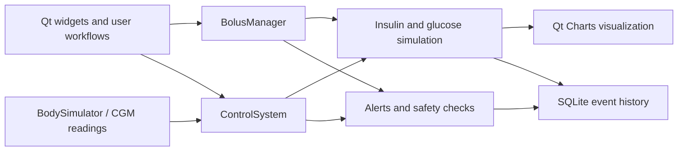

# Tandem t:slim X2 Insulin Pump Simulator

> A documentation-only showcase of a four-person team project for the Object-Oriented Software Engineering class at Carleton University. The original course source code remains private.

This project simulates the user interface and safety-oriented workflows of an insulin pump. It combines a Qt desktop interface, a time-compressed body/glucose simulation, configurable personal profiles, bolus delivery, automated basal adjustments, alert handling, and persisted event history.

**Important:** This is an educational software simulation. It is not a medical device, is not clinically validated, and must not be used to make treatment decisions.

## My contributions - Khalifeh Basiri

I focused on the insulin-calculation and automated-control path:

- Designed the `BolusManager` domain logic for carbohydrate and correction calculations, dose previews, manual delivery, input validation, and configurable safety limits.
- Integrated manual bolus delivery with the body/glucose simulator and implemented correction-bolus confirmation behavior.
- Designed the `ControlSystem` flow for CGM-driven insulin-rate adjustment, glucose trend handling, safety thresholds, and automatic suspend/resume behavior.
- Implemented alert definitions and escalation behavior for glucose excursions, rapid trends, insulin overdose/underdose, system faults, and failed delivery resumption.
- Connected insulin-control results to the interface and backend so glucose trends could drive delivery state, visualization, and history updates.
- Helped integrate extended-bolus behavior. The final extended-delivery and visualization path was shared work with Julien Larivière-Chartier.

See [Team contributions](CONTRIBUTIONS.md) for the complete attribution and collaboration boundaries.

## Project highlights

- **Bolus workflow:** carbohydrate and correction components, detailed dose preview, manual override, validation, safety caps, standard delivery, and extended delivery.
- **Automated insulin control:** CGM readings feed a control component that adjusts insulin delivery, detects unsafe conditions, and suspends or resumes delivery.
- **Safety behavior:** configurable low/high glucose thresholds, rapid-rise/drop detection, delivery-state guards, battery and cartridge scenarios, and severity-based alerts.
- **Simulation:** one real-time second advances the project clock by five simulated minutes, making long-running glucose and insulin behavior observable during a demo.
- **Visualization:** Qt Charts display glucose history, thresholds, trends, and highlighted delivery/safety intervals.
- **Persistence:** SQLite-backed profiles, basal changes, bolus events, warnings, and records can be reviewed from the interface.

## Technology

`C++11` · `Qt Widgets` · `Qt Charts` · `Qt SQL` · `SQLite` · `qmake` · `signals/slots` · `UML` · `Doxygen` · `Git`

## Demo videos

| Scenario | What it demonstrates |
| --- | --- |
| [Success scenario 1](https://youtu.be/dCezgP-P2d4) | UI tour, profile creation and activation, scheduled profiles, automatic insulin delivery, and recorded basal changes. |
| [Success scenario 2](https://youtu.be/tJMpMrLWkEg) | Manual, extended, and automatic bolus delivery; graph highlights; alert and record history. |
| [Safety scenario 1](https://youtu.be/DuQRoASgmRc) | Low/critical battery alerts, automatic shutdown, restart, and persisted warning history. |
| [Safety scenario 2](https://youtu.be/sf8nXzPyNlg) | Empty-cartridge handling, stopped insulin delivery, and recorded warnings. |

### Application snapshots

| Profile and automatic-delivery flow | Bolus and glucose visualization |
| --- | --- |
|  |  |

| Battery safety scenario | Cartridge and glucose alert scenario |
| --- | --- |
|  |  |

The snapshots are public video thumbnails from the team's final demonstrations.

## Architecture at a glance

The application uses Qt signals and slots to keep interface actions, simulated glucose updates, delivery decisions, alerts, chart changes, and persistence loosely coupled.

- [Architecture and design notes](docs/architecture.md)
- [Verification and traceability summary](docs/verification-and-traceability.md)
- [Full UML class diagram](assets/diagrams/uml-class-diagram.png)
- [State-machine diagrams](assets/diagrams/uml-state-machines.png)
- [Normal-use sequence diagrams](assets/diagrams/sequence-normal-use.png)
- [Safety-event sequence diagrams](assets/diagrams/sequence-safety-events.png)

## Repository scope

This public repository intentionally contains portfolio documentation, diagrams, screenshots, and links to demonstrations only. It does **not** contain:

- the private course source code;
- generated source listings or Doxygen pages;
- assignment handouts or full submitted reports;
- databases, credentials, build artifacts, or test data.

The original application was developed in Qt Creator with Qt Widgets, Qt Charts, and Qt SQL. Because the implementation remains private, this showcase is not intended to be built or installed. For the rationale and publication boundary, see [Repository scope](docs/repository-scope.md).

## Team

Developed by a four-person team for **the Object-Oriented Software Engineering** class at **Carleton University**:

- Khalifeh Basiri
- Julien Larivière-Chartier
- Shang Shi
- Matthew Murphy

This showcase identifies individual and shared work without presenting the application as a solo project. See [CONTRIBUTIONS.md](CONTRIBUTIONS.md) for details.

## Notice

This project is an independent educational simulation and is not affiliated with, endorsed by, or sponsored by Tandem Diabetes Care, Inc. Product and company names are used only to describe the simulated system. See [NOTICE.md](NOTICE.md).
