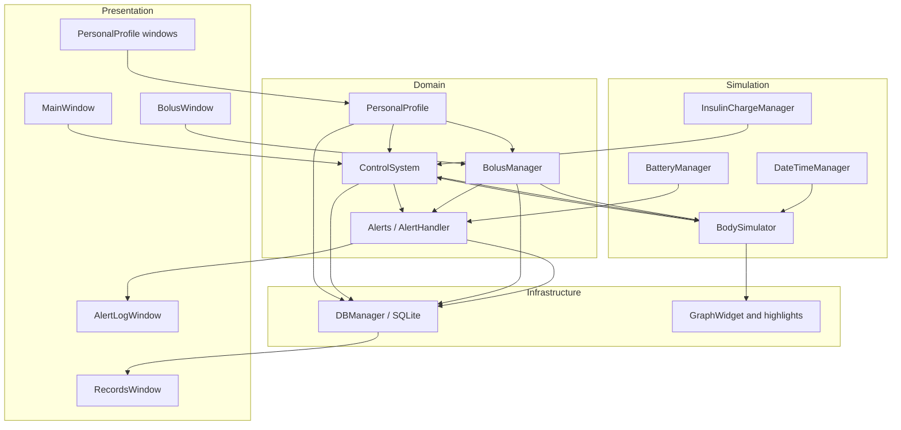

# Architecture and design notes

## System shape

The simulator is a C++11 desktop application built with Qt Widgets, Qt Charts, Qt SQL, and SQLite. Its design separates interface concerns, insulin-delivery decisions, simulated physiology, safety alerts, visualization, and persistence into cooperating QObject-based components.

## Bolus path

The bolus workflow separates calculation from delivery:

1. The user supplies carbohydrate and glucose inputs in the bolus window.
2. `BolusManager` validates the inputs and calculates carbohydrate and correction components using the active profile.
3. The manager returns a detailed preview so the interface can present the suggested total and support confirmation or override.
4. Safety limits are applied before delivery.
5. Standard or extended delivery updates the simulator, visualization, insulin-on-board state, and event history.
6. Rejected inputs and unsafe values route through the alert path.

## Automated-control path

`BodySimulator` emits glucose readings and direction changes. `ControlSystem` evaluates each update against the target, recent trend, delivery state, and configured limits. It can adjust the insulin rate, emit trend information, suspend delivery, or request a safe resume. A delivery-state provider prevents resumption when external state such as the battery or cartridge makes delivery unavailable.

## Safety and alerts

The alert subsystem tracks active alert types and severity. It provides consistent UI messages, routes display and record actions, and distinguishes informational, warning, critical, and emergency conditions. Examples include glucose excursions, rapid glucose changes, potential insulin overdose, low battery, empty cartridge, system error, and rejected resumption.

## Time and visualization

The application advances five simulated minutes per real-time second. This makes basal adjustments, bolus effects, glucose trends, battery drain, and cartridge consumption visible during short demos. The graph layer plots glucose values and target thresholds while highlight components show extended delivery and unsafe regions.

## Design artifacts

- [UML class diagram](../assets/diagrams/uml-class-diagram.png)
- [UML state machines](../assets/diagrams/uml-state-machines.png)
- [Normal-use sequence diagrams](../assets/diagrams/sequence-normal-use.png)
- [Safety-event sequence diagrams](../assets/diagrams/sequence-safety-events.png)

These diagrams are team-produced artifacts from the final course submission and are included for architectural discussion, not as reusable implementation specifications.
